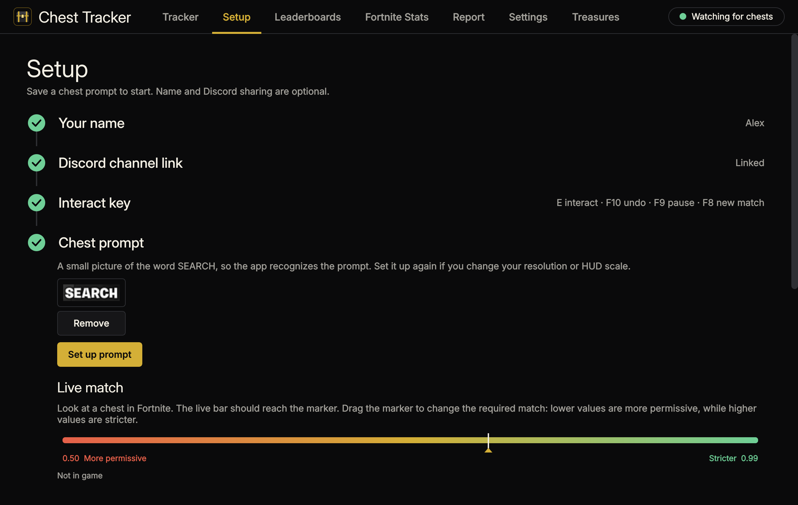
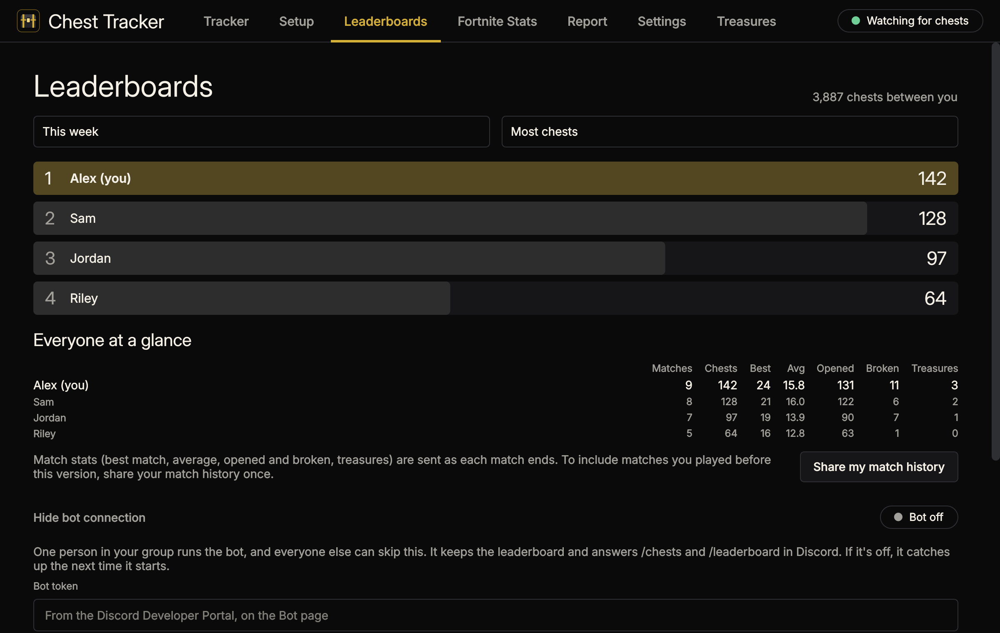
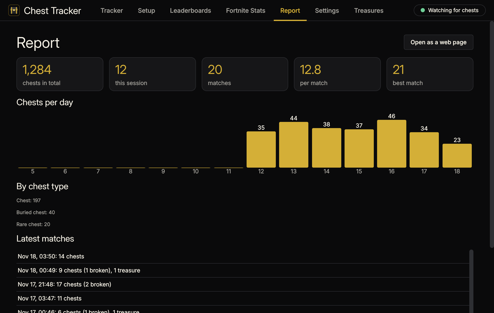
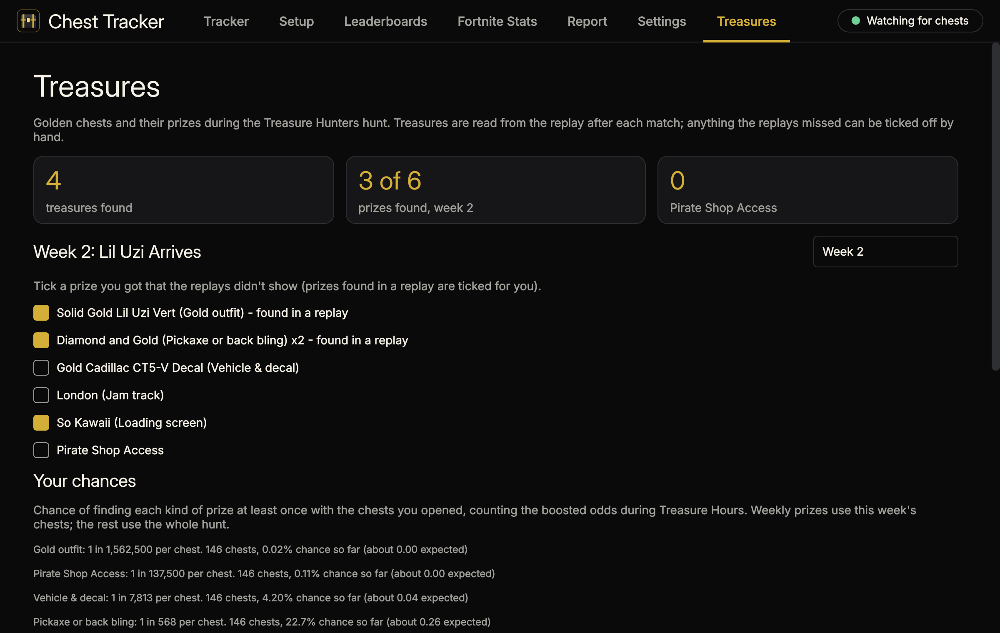

<p align="center">
  
</p>

<p align="center">
  <a href="../../releases/latest/download/Chest-Tracker.exe"><b>Download for Windows</b></a>
  &nbsp;&nbsp;|&nbsp;&nbsp;
  <a href="#how-a-chest-gets-counted">How counting works</a>
  &nbsp;&nbsp;|&nbsp;&nbsp;
  <a href="#set-up-the-discord-bot">Set up the Discord bot</a>
</p>

<p align="center">
  <a href="../../actions/workflows/tests.yml"></a>
  
  
  
</p>

Chest Tracker counts the Fortnite chests you open and can keep a shared leaderboard in Discord. It also works in local-only mode: counts stay on this PC and no Discord setup is needed.

Chest Tracker began from [Xxoris190/chest-tracker](https://github.com/Xxoris190/chest-tracker) and has since grown a lot. The original author keeps their copyright and the MIT license notice is kept (see [License](#license)).

<p align="center">
  
</p>

<sub>Screenshots and this animation show sample data.</sub>

## What it does

- **Counts real searches.** Cancelled searches and chests you only walk past don't count.
- **Shows it live.** The chest on screen lifts its lid during a search, bursts open when a chest counts, and slams shut on a cancel.
- **Works without Discord.** Your local totals and activity history work without a webhook or bot.
- **Leaderboards for your group.** Optionally connect Discord to rank everyone by chests, best match, average per match, chests opened or broken, treasures found and matches played, for this week, this season or all time. The bot also answers `/chests` and `/leaderboard`.
- **Can show Fortnite stats.** Look up public Battle Royale stats by player name with an optional Fortnite-API.com key.
- **Doesn't lose chests.** If Discord can't be reached, chests are saved and sent later, and the bot catches up after being offline.
- **Works with your binds.** Use any key, a mouse button, the scroll wheel, or an Xbox-style controller button to interact.
- **Finds your screen.** It follows Fortnite to whichever monitor it's on.
- **Pause key.** Press **F9** in Fortnite to stop counting (say, in a party lobby or when you are messing about) and press it again to resume. The overlay shows PAUSED.
- **Exact counts from Fortnite's replay.** When a match ends, the app reads the replay file and uses its exact count, including chests you broke rather than opened, with how many were opened and broken and the chest types. If the replay can't be read, the screen count is kept.
- **Match history and reports.** A **Report** tab shows days, weeks and months as charts and lists; click a match for its details. **Edit total...** lets you correct your total (and undo it), import from ChestCounter or the older Chest Tracker, and **Count my past replays** to fill in older matches from the replays Fortnite has kept.
- **Treasure Hunters hunt.** The **Treasures** tab shows the week's golden-chest prizes, what you've found, your chances, Treasure Hours, and your finds. Finds are read from replays, and you can tick off any the replays missed. Past weeks stay available. The hunt data comes from [ChestCounter's](https://github.com/LED-N/Fortnite-ChestCounter) content file and updates without a new release.
- **Goals.** Set a chests-per-day goal and a chests-per-match goal. Progress bars show on the Tracker tab and the overlay, with a day streak, and a chime plays when you reach one.
- **Backups.** A daily automatic backup (last 7 kept) plus **Back up now...** and **Restore from a backup...** in **Settings**.
- **Optional chime.** A short sound when a chest is counted, for when you miss the animation. Off by default, with its own volume.
- **Optional in-game overlay.** Show the chest count over Fortnite, drag it clear of your HUD in Setup, and mouse input passes through while playing. You can change its size and opacity in Setup. The overlay is excluded from the app's own screen capture, so it can't be mistaken for part of the game.

## Get started

1. Download [`Chest-Tracker.exe`](../../releases/latest/download/Chest-Tracker.exe) and double-click it. The app is Windows-only: Fortnite no longer runs natively on macOS, and the app relies on Windows screen and input features.
2. If Windows shows "Windows protected your PC", select **More info**, then **Run anyway**. It appears because the app isn't signed with a paid certificate.
3. Open **Setup** and set the **Interact key** and **Chest prompt**. To calibrate the prompt, set Fortnite to **Windowed Fullscreen**, select **Set up prompt**, look at a chest, and press **F8**. Drag a box around the prompt to zoom in, then drag a tight box around only the word **SEARCH**.
4. Play. The app starts watching whenever Fortnite is the active window, and saves counts on this PC.

To share counts with a group, add your player name and Discord webhook in **Setup**. In Discord, open the channel's **Edit Channel > Integrations > Webhooks**. The Discord bot and leaderboard are optional too.

Open **Fortnite Stats** to enter a Fortnite-API.com key, player name and account platform, then select **Refresh stats**. The page shows lifetime or current-season overall and Solo/Duo/Squad stats. Stats requests are manual; the app doesn't sign in to Epic. Fortnite-API.com is an independent, non-official service and requires its own API key for stats. You can create one at the [Fortnite-API dashboard](https://dash.fortnite-api.com/account).

To use the in-game overlay, open **Setup**, enable **Show the chest count over Fortnite**, select **Set overlay position**, and drag the badge where you want it. Select **Done positioning** before returning to Fortnite. The overlay is hidden when Fortnite isn't the active window. **Size** and **Opacity** change as you drag the sliders; the badge is only visible during **Set overlay position** or in the game. It needs Windows 10 version 2004 or newer to stay out of the app's screen reads; on older builds, keep it away from the middle of the screen.

Closing the window keeps it counting from the system tray. To exit, right-click the tray icon and select **Quit**.

<p align="center">
  
  
</p>

<p align="center">
  
  
</p>

## How a chest gets counted

Fortnite has no official way to report chest opens, so the app works it out from the screen. A chest counts about 3 seconds after you search it, once all of these are true:

1. The SEARCH prompt was on screen and you used your interact key.
2. You kept aiming at the chest for the first second.
3. The prompt stayed gone for the full 3 seconds.

If the prompt comes back while you are still aiming at the same spot, or you look away during that first second, the search is cancelled. There is one exception, so a fast run of chests isn't missed: if the prompt comes back only after your view has turned somewhere new, and you had kept your aim for that first second, you finished and moved on, so that chest counts straight away.

Counted one by mistake? Press **F10** while Fortnite is focused, or select **Remove last chest**. You can choose a different keyboard key in **Setup**; the app asks first if you pick one you also type with, because chat in Fortnite would then remove chests. Removing a chest when your count is already 0 does nothing, and nothing is sent to Discord.

To pause, press **F9** while Fortnite is focused or use **Pause tracking** in the window or tray. Nothing is counted while paused, and a search under way when you pause is dropped. Pausing also forgets presses made while paused. Undo, pause and interact must be three different keys. To hear the chime, turn it on under **Chime** in Setup and use **Play sound** to check the volume. Players can't add chests by hand, but someone with Manage Server can use `/add` in Discord.

### Matches

The tracker counts chests per match as well as in total. **This match** appears on the Tracker page and, if you leave **Also show this match's chest count** on in Setup, on the in-game overlay. When a match ends, the app saves its count and starts the next one at zero. Your all-time, today and Discord totals are not affected.

A match ends when the app sees Fortnite's end-of-match screen (the one with **Return to lobby** and **Play again**). That screen only appears once your whole team is out or you leave, so spectating doesn't end a match. If the app misses it, press **F8** in Fortnite or click **New match**. F8 can be changed in Setup, and it must differ from your other keys.

The Tracker page shows the average, median and best chests per match. Matches with no chests are never saved, so they don't pull the average down. **Export history** saves the matches as a CSV file for a spreadsheet. A match still open when the app starts is carried on if it began within two hours, and closed otherwise.

### Replay counting

The screen can't see chests that are broken rather than opened, but Fortnite's replay records every chest you searched. After each match the app waits for the replay (it can take a minute or two to finish writing), reads it with the bundled `chest-scan` program, and uses that count instead of the screen count. This needs **Record Replays** turned on in Fortnite's settings; if it's off, or the replay can't be read, the screen count stands. If that happens for 3 matches in a row, a banner says why. You can turn this off under **Replay counting** in **Setup**, and point the app at a different replay folder in **Settings**.

**Count my past replays** (in **Edit total...**) reads the replays Fortnite still has and fills in your history from the start of the season (editable). Counts from before the replays are kept, and matches covered by a replay get the replay's count.

### Treasures

The **Treasures** tab covers the Treasure Hunters hunt: the week's prizes (choose any week that has started), your chances, Treasure Hours, and your latest finds. Prizes found in a replay are ticked for you; tick any others by hand. If a treasure is found in a replay, a line goes to your match channel in Discord (you can turn this off in Settings), and during the hunt the overlay can show a Treasure Hour countdown.

### Leaderboards

When your app is set up with a player name and webhook, each finished match sends a short stats line (the match's time, chests, how many were opened and broken, and treasures found) to the same channel as your chest counts. The bot reads these to build the **Leaderboards** tab, which only the person running the bot sees, and the `/leaderboard` command. **Share my match history** sends your matches from this season once. Weekly boards start on Monday; the season starts on the date in **Count my past replays**. Match stats need everyone's app to be version 1.9.0 or newer, and the bot to be the new version too.

### Settings, backups and messages

The **Settings** tab holds the 12 or 24 hour clock, minimize to tray, start with Windows (starts minimized), the overlay options, replay folder, and backups. Backups hold your total, match history, list of changes and ticked treasures; Discord settings are never included. The app can also show a short plain-text message from the developer (for example "a Fortnite update broke replay reading"), which you can dismiss or turn off in **Settings**. Those messages come from [`notices.json`](NOTICES.md) in this repository.

### Updates

In **Setup**, under **Updates**, choose what the app does about new versions:
- **Tell me when there's a new version** (the default): a banner appears with **What's new** and **Install and restart**.
- **Install new versions automatically**: installs when no match with chests is open and Fortnite isn't the active window, then restarts.
- **Don't check for updates**: nothing is checked.

**Check for updates** checks right away. The app asks GitHub for the latest release of this project (`benbryan-ai/chest-tracker`), so it only works while the releases are public. It can jump several versions at once. A download is only installed if it matches the checksum GitHub lists for it, and the old version is put back if the install fails. The exe isn't code-signed, so Windows may show its "protected your PC" screen. If you run the app from source, the update button opens the releases page instead.

### Known limits

The app can't see inside the game, so these rules are strong evidence rather than proof.

- Holding your aim past the first second and then cancelling could still count.
- A search that finishes makes the prompt vanish about a second after you press, so it counts right away, even if you turn or walk off at once. Searches that end any other way still use the slower confirm rule, which can miss a chest if you turn back to it within 3 seconds.
- Ammo and fruit boxes are skipped by their colors, learned from example screenshots. It only skips when it is fairly sure, so an odd-looking box can still count (use undo), and a brand-new chest skin could in theory be skipped. The log says how chest-like each object looked.
- Anyone with the webhook URL could post to the channel directly, so only share it with people you trust.
- Controllers: only Xbox-style pads (or ones that present themselves as Xbox pads) work, and only for the interact button. The undo key is still a keyboard key. PlayStation pads need Steam Input or DS4Windows to look like an Xbox pad.

## Set up the Discord bot

Only one person in your group needs to do this. Everyone else only needs the shared webhook URL.

| Discord command | What it does |
| --- | --- |
| `/chests` | Everyone's total and today's count. Add a player name to see just theirs. |
| `/leaderboard` | Top 10 players. Choose a period (this week, this season, all time) and a category (most chests, best match, average, opened, broken, treasures, matches). Defaults to this week, most chests |
| `/add` | Corrects a player's count (Manage Server only) |
| `/reset` | Sets a player's count to 0 (Manage Server only) |

1. Go to the [Discord Developer Portal](https://discord.com/developers/applications), select **New Application**, then open **Bot**.
2. Select **Reset Token** and copy the token. Keep it secret, because anyone who has it controls your bot.
3. On the same page, turn on **Message Content Intent**.
4. Under **OAuth2 > URL Generator**, tick the scopes `bot` and `applications.commands`, and the permissions **View Channels**, **Read Message History** and **Send Messages**. Open the generated link and add the bot to your server.
5. Create a channel just for this, such as `#chest-log`, and make sure the bot can see it.
6. In Discord, turn on **User Settings > Advanced > Developer Mode**, then right-click the channel and select **Copy Channel ID**.
7. In the app's **Leaderboards** tab, select **Show bot connection**, paste the token and channel ID, and select **Start bot**.

### Match reports and group game reports

Optional, and separate from the chest log above. Match reports go to a second webhook, so they can go to a different channel.

1. Create a second channel, such as `#match-reports`, and add a webhook to it (Edit Channel, Integrations, Webhooks). Everyone who wants to post matches pastes that URL under **Match reports** in Setup, next to the first webhook. You also need a player name, as for the chest log.
2. When a match ends, the app posts one line, for example `14 chests this match`. Tick off **Post each match to Discord** if you'd rather not share your matches, for example when you play solo. Your match history stays on your PC either way.
3. For a **group game report**, everyone in the squad enters the same **party code** in Setup (3 to 12 letters or numbers, such as `SQUAD42`). The line then carries the code.
4. The person running the bot pastes the match channel's ID into **Match reports channel ID** on the Leaderboards tab, and the bot needs **View Channels** and **Send Messages** there. If it's a different channel than the first, make sure the bot can see both.
5. After the first player's line arrives, the bot waits 3 minutes for the rest of the team (or until 4 players have reported), then posts one report with each player's chests, the team total and who opened the most. It needs at least 2 players. The report is only built while the bot is running, and a report that is pending when the bot stops isn't posted.

A player who opened no chests that match has no line, so they aren't in the report.

## Privacy and anti-cheat

**What the app does:** it takes screenshots while Fortnite is the active window and reads which keys and scroll input you use. It doesn't touch Fortnite's memory, and it doesn't press anything for you. After a match it only reads (never changes) the replay file Fortnite saved, on your PC, using the bundled `chest-scan` program.

**What it sends:** The app asks GitHub for the latest release, for developer messages, and for the treasure hunt data now and then (it downloads these; nothing about you is sent). Update checks can be turned off. Discord is optional; if configured, the app sends your player name and chest count to your webhook, and, if you set the match reports webhook, your chests per match, party code and any treasures found. If you use Fortnite Stats, the app sends the player name and Fortnite-API key to Fortnite-API.com over HTTPS when you select **Refresh stats**. The key and most recent result are stored in the local settings file; the key is not sent to Discord. Screenshots stay in memory and are thrown away. The only image saved for detection is the small prompt picture you select, on your own PC.

**Where your data lives:** your settings, API key, webhook URL and bot token are in `%APPDATA%\ChestTracker`, not in the `.exe`.

> [!WARNING]
> This is much lower risk than anything that modifies the game, but nobody can promise it's allowed under Epic's rules. Use it at your own risk.

## Troubleshooting

**Chests aren't being counted.** Open **Setup > Chest prompt** and watch **Live match** while you look at a chest in Fortnite.

- **The bar stays below the marker:** set up the prompt again. You can save several, such as one in a dark area. Remove old ones after changing resolution or HUD scale.
- **The status says "Can't see the game":** use Windowed Fullscreen, and try turning HDR off.
- **The bar passes but nothing counts:** check that **Interact key** matches your Fortnite binding.
- **Controller button isn't picked up:** in **Setup**, select the interact key box and press the button on the controller. It should appear as, for example, "Controller A button". Use the button you have bound to interact in Fortnite. If nothing happens, check that Windows sees the controller (Settings, Bluetooth & devices).

**Real chests show "Search cancelled".** Keep aiming at the chest for a second after searching.

**It counts when no prompt is showing.** Drag the **Live match** marker up to about 0.85 or 0.9.

**The Discord post fails.** Discord refuses player names that contain "discord" or "clyde", so Setup won't save one. If the app says Discord rejected your name, pick another in **Setup > Your name**. Your chests stay saved and are sent once it's fixed.

**Something else is wrong.** Check the log at `%APPDATA%\ChestTracker\chest-tracker.log`. It's useful to include in a bug report, and it doesn't contain your token or webhook URL.

### Help improve the box filter

Each attempt is logged, for example:

```
Attempt opened: 1.2s after pressing, key used for 0.1s, prompt gone 0.4s, lowest aim match 0.93, final match 0.95, prompt vanished 0.78s after pressing (steady view: True)
Object looked 91% like a chest
```

If a box was counted, or a chest was skipped ("Not counted: looks like an ammo or fruit box"), send those log lines and a screenshot taken while the SEARCH prompt shows. To add examples yourself, put screenshots in `examples/chest/` and `examples/box/` and run `python tools/train_box_filter.py examples --keep`.

## Build from source

You need Windows and Python 3.12. To build the replay reader as well you need the [.NET 10 SDK](https://dotnet.microsoft.com/download); without it the app still builds, but without replay counting (the release build requires it).

```bash
python -m venv .venv-app
```

```bash
.venv-app\Scripts\python.exe -m pip install -r requirements-dev.txt
```

Run the app:

```bash
.venv-app\Scripts\python.exe app.py
```

Run the tests:

```bash
.venv-app\Scripts\python.exe -m pytest
```

Build `Chest-Tracker.exe`:

```bash
powershell -ExecutionPolicy Bypass -File build.ps1
```

| File | What it holds |
| --- | --- |
| `detection.py` | The rules that decide whether a search counts |
| `watcher.py` | Screen capture, input checks, and sending to Discord |
| `wheel.py` | Scroll wheel detection through Windows raw input |
| `gamepad.py` | Xbox-style controller buttons through XInput |
| `bot.py`, `store.py` | The Discord bot and its database |
| `ui.py`, `widgets.py`, `overlay.py` | The app window, animated chest and in-game count badge |
| `boxfilter.py`, `tools/train_box_filter.py` | Skips ammo and fruit boxes by color, and the script that retrains it from screenshots |
| `updater.py`, `version.py` | Checks GitHub for new releases and installs them; the version number |
| `reports.py` | The group game report: waits for teammates and ranks them |
| `matches.py`, `recap.py` | Chests per match and its history, and the end-of-match screen check |
| `replays.py`, `scanner/` | Reads a finished match's replay with the bundled `chest-scan` program (.NET) |
| `backfill.py`, `importer.py`, `adjustments.py` | Counting past replays, importing from other trackers, and the editable list of total changes |
| `boards.py`, `store.py`, `bot.py` | The leaderboard periods and categories, the bot's database, and the Discord bot |
| `report.py`, `timefmt.py` | The Report tab's numbers and the clock format |
| `content.py`, `treasures.py`, `marks.py` | The treasure hunt data, chances and finds, and hand-ticked prizes |
| `backup.py`, `notices.py`, `startup.py` | Backups, developer messages, and starting with Windows |
| `chime.py` | The optional counted-chest sound, generated in code |
| `fortnite_stats.py` | The optional Fortnite-API player-stats lookup |
| `settings.py`, `protocol.py` | Saved settings and counts, and the rules for names, webhook links and messages |
| `tools/make_screenshots.py` | Draws the README screenshots from sample data (`python tools/make_screenshots.py docs/images`) |
| `tests/` | The automated tests. They run on any OS, since the Windows calls are stubbed |

To publish a release:
1. Change `VERSION` in `version.py` (for example to `1.2.0`).
2. Add a `## v1.2.0` section at the top of `RELEASE_NOTES.md` (below its intro) listing what changed. This becomes the release text and the app's "What's new".
3. Commit and push, then tag it: `git tag v1.2.0` and `git push origin v1.2.0`.

The **Release** workflow checks the tag matches `version.py` and that the notes section exists, runs the tests, builds `Chest-Tracker.exe` and attaches it to a GitHub release, which is what the download link and the in-app updater serve.

To test only the replay reader, tag `scanner-v0.0.1` (any `scanner-v*` tag) and the **Scanner** workflow builds `chest-scan.exe` for you.

## Credits and license

[MIT](LICENSE). Chest Tracker began from [Xxoris190/chest-tracker](https://github.com/Xxoris190/chest-tracker), whose copyright notice is kept in the license.

The replay reader (`scanner/`) is built on [LED-N's ChestCounter](https://github.com/LED-N/Fortnite-ChestCounter) and a patched FortniteReplayDecompressor, both MIT; see `scanner/THIRD_PARTY_NOTICES.md`. The treasure hunt data comes from ChestCounter's content file.

Chest Tracker is an unofficial fan project. It isn't affiliated with, endorsed by, or sponsored by Epic Games. Fortnite is a trademark of Epic Games, Inc.
